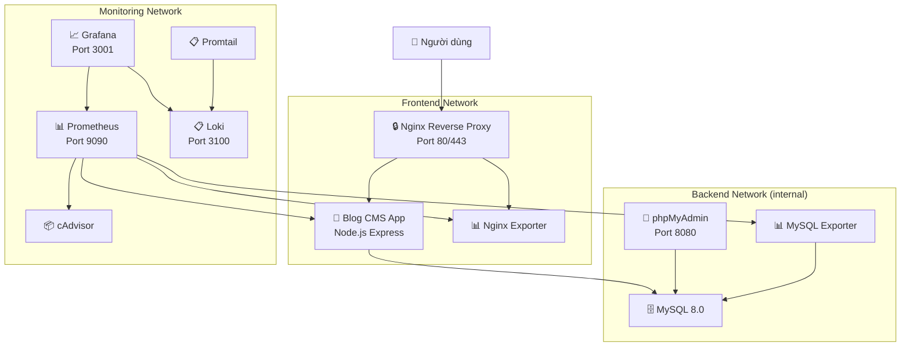

# 📝 Hệ thống Blog / CMS - Đồ án Triển khai và Quản trị HTPM

<div align="center">


</div>

---

## 📋 Thông tin sinh viên

| Thông tin | Chi tiết |
|-----------|----------|
| **Họ và tên** | Hoàng Duy Mạnh |
| **Mã sinh viên** | DTC245200060 |
| **Email** | dtc245200060@ictu.edu.vn |
| **Lớp** | CNTT K23B |
| **Trường** | Đại học Công nghệ Thông tin và Truyền thông (ICTU) |
| **Môn học** | Triển khai và Quản trị Hệ thống Phần mềm |
| **Đề tài** | Đề 7 - Hệ thống Blog / CMS (Quản lý bài viết, danh mục, người dùng) |

---

## 🏗️ Sơ đồ kiến trúc hệ thống

```
┌─────────────────────────────────────────────────────────────────────┐
│                        NGƯỜI DÙNG (Browser)                        │
│                    http://localhost (port 80)                       │
│                    https://localhost (port 443)                     │
└───────────────────────────┬─────────────────────────────────────────┘
                            │
                ┌───────────▼───────────┐
                │   🔒 NGINX REVERSE    │
                │      PROXY            │
                │  (SSL + Security      │
                │   Headers)            │
                │  Port: 80, 443        │
                └───────────┬───────────┘
                            │
        ┌───────────────────┼───────────────────┐
        │            FRONTEND_NET               │
        │                                       │
┌───────▼───────┐                    ┌──────────▼──────────┐
│  📱 BLOG APP  │                    │  📊 NGINX EXPORTER  │
│  (Node.js     │                    │  (Port: 9113)       │
│   Express)    │                    └──────────┬──────────┘
│  Port: 3000   │                               │
└───┬───────┬───┘                               │
    │       │                                   │
    │  ┌────┼───────────────────────────────────┼────────────────┐
    │  │    │         BACKEND_NET (internal)    │                │
    │  │    │                                   │                │
    │  │  ┌─▼──────────┐  ┌──────────────┐  ┌──▼─────────────┐  │
    │  │  │  🗄️ MySQL  │  │ 🔧 phpMyAdmin│  │📊 MySQL       │  │
    │  │  │  8.0       │  │ Port: 8080   │  │   Exporter    │  │
    │  │  │  Port:3306 │  └──────────────┘  │   Port: 9104  │  │
    │  │  └────────────┘                    └───────────────┘  │
    │  └───────────────────────────────────────────────────────┘
    │
    │  ┌───────────────────────────────────────────────────────┐
    │  │              MONITORING_NET                            │
    │  │                                                       │
    │  │  ┌─────────────┐  ┌─────────────┐  ┌──────────────┐  │
    │  │  │📊 Prometheus│  │ 📈 Grafana  │  │ 📦 cAdvisor  │  │
    │  │  │ Port: 9090  │  │ Port: 3001  │  │ Port: 8081   │  │
    │  │  └─────────────┘  └─────────────┘  └──────────────┘  │
    │  │                                                       │
    │  │  ┌─────────────┐  ┌─────────────┐                    │
    │  │  │ 📋 Loki     │  │ 📋 Promtail │                    │
    │  │  │ Port: 3100  │  │ Port: 9080  │                    │
    │  │  └─────────────┘  └─────────────┘                    │
    │  └───────────────────────────────────────────────────────┘
    │
```

### Sơ đồ Mermaid



---

## 📂 Cấu trúc thư mục

```
DTC245200060_DE7_BLOGCMS/
├── 📂 app/                          # Source code ứng dụng Blog CMS
│   ├── 📂 public/css/style.css      # Stylesheet (Dark mode UI)
│   ├── 📂 views/                    # EJS Templates
│   │   ├── 📂 partials/             # Header, Navbar, Footer
│   │   ├── 📂 posts/                # CRUD views cho Bài viết
│   │   ├── 📂 categories/           # CRUD views cho Danh mục
│   │   ├── 📂 users/                # CRUD views cho Người dùng
│   │   ├── index.ejs                # Trang chủ
│   │   └── error.ejs                # Trang lỗi
│   ├── server.js                    # Express server + routes + metrics
│   ├── package.json                 # Dependencies
│   ├── Dockerfile                   # Multi-stage build, non-root user
│   └── .dockerignore
├── 📂 mysql/
│   └── init.sql                     # Tạo bảng + dữ liệu mẫu + phân quyền
├── 📂 nginx/
│   ├── nginx.conf                   # Reverse proxy + SSL + Security headers
│   └── 📂 ssl/                      # Chứng chỉ SSL (auto-generated)
├── 📂 prometheus/
│   └── prometheus.yml               # Cấu hình scrape targets
├── 📂 grafana/
│   ├── 📂 provisioning/
│   │   ├── 📂 datasources/          # Auto-provision Prometheus + Loki
│   │   └── 📂 dashboards/           # Dashboard provisioning config
│   └── 📂 dashboards/
│       └── blog-cms-dashboard.json  # Dashboard giám sát hệ thống
├── 📂 loki/
│   └── loki-config.yml              # Cấu hình Loki
├── 📂 promtail/
│   └── promtail-config.yml          # Cấu hình thu thập log
├── docker-compose.yml               # Docker Compose (11 services)
├── generate-ssl.sh                  # Script tạo chứng chỉ SSL tự ký
├── setup_and_push_commits.sh        # Script push 3 commits lên GitHub
├── .env                             # Biến môi trường (KHÔNG commit)
├── .env.example                     # Template biến môi trường
├── .gitignore                       # Ignore rules
└── README.md                        # File này
```

---

## 🚀 Hướng dẫn cài đặt và khởi chạy

### Yêu cầu hệ thống

- **Docker** >= 20.10
- **Docker Compose** >= 2.0
- **Git**
- **OpenSSL** (để tạo chứng chỉ SSL)

### Bước 1: Clone repository

```bash
git clone https://github.com/dtc245200060-ops/dtc245200060_DE7_BLOGCMS.git
cd dtc245200060_DE7_BLOGCMS
```

### Bước 2: Cấu hình biến môi trường

```bash
# Copy file .env mẫu
cp .env.example .env

# Chỉnh sửa mật khẩu trong file .env (nếu cần)
nano .env
```

### Bước 3: Tạo chứng chỉ SSL tự ký

```bash
# Trên Linux/Mac:
chmod +x generate-ssl.sh
./generate-ssl.sh

# Trên Windows (Git Bash):
bash generate-ssl.sh

# Hoặc tạo thủ công:
mkdir -p nginx/ssl
openssl req -x509 -nodes -days 365 -newkey rsa:2048 \
    -keyout nginx/ssl/server.key \
    -out nginx/ssl/server.crt \
    -subj "/C=VN/ST=Thai Nguyen/L=Thai Nguyen/O=ICTU/OU=CNTT K23B/CN=localhost/emailAddress=dtc245200060@ictu.edu.vn"
```

### Bước 4: Khởi chạy toàn bộ hệ thống

```bash
docker compose up -d --build
```

### Bước 5: Kiểm tra trạng thái

```bash
# Xem trạng thái tất cả containers
docker compose ps

# Xem logs
docker compose logs -f blog-app

# Kiểm tra health
curl http://localhost/health
```

---

## 🌐 Bảng cổng dịch vụ và tài khoản đăng nhập

| Dịch vụ | URL | Port | Tài khoản | Mật khẩu |
|---------|-----|------|-----------|----------|
| **Blog CMS (HTTP→HTTPS)** | http://localhost | 80 | *(Không yêu cầu)* | *(Không yêu cầu)* |
| **Blog CMS (HTTPS)** | https://localhost | 443 | *(Không yêu cầu)* | *(Không yêu cầu)* |
| **phpMyAdmin (User thường)** | http://localhost:8088 hoặc https://localhost/phpmyadmin/ | 8088 / 443 | `blog_user` | `BlogUser@2024!Secure` |
| **phpMyAdmin (Root)** | http://localhost:8088 hoặc https://localhost/phpmyadmin/ | 8088 / 443 | `root` | `R00t@BlogCMS!2024_Str0ng` |
| **Grafana Dashboard** | http://localhost:3001 | 3001 | `admin` | `Grafana@Admin!2024` |
| **Prometheus Web UI** | http://localhost:9090 | 9090 | *(Không yêu cầu)* | *(Không yêu cầu)* |
| **Loki (Health check)** | http://localhost:3100/ready | 3100 | *(Không yêu cầu)* | *(Không yêu cầu)* |
| **Loki (Metrics)** | http://localhost:3100/metrics | 3100 | *(Không yêu cầu)* | *(Không yêu cầu)* |
| **Loki (LogQL Explore)** | http://localhost:3001/explore | 3001 | `admin` *(qua Grafana)* | `Grafana@Admin!2024` |
| **App Health** | http://localhost/health | 80 | *(Public)* | *(Public)* |
| **App Metrics** | https://localhost/metrics | 443 | *(Public)* | *(Public)* |

> **⚠️ Lưu ý port 443 trên Docker Desktop Windows:**  
> Khi click vào `443:443` trong giao diện Docker Desktop, trình duyệt mở `http://localhost:443` (HTTP thuần).  
> Nginx đã được cấu hình `error_page 497` để tự động redirect sang `https://localhost` — không còn báo lỗi 400.

> **⚠️ Lưu ý Loki port 3100:**  
> Loki **không có route `/`** nên truy cập `http://localhost:3100` trực tiếp sẽ hiện `404 page not found` — đây là hành vi bình thường.  
> Kiểm tra Loki còn sống bằng: `http://localhost:3100/ready` (trả về `ready`) hoặc `http://localhost:3100/metrics`.  
> Để truy vấn log bằng LogQL với giao diện đồ họa: `http://localhost:3001/explore` (Grafana Explore → chọn datasource **Loki**).

---

## 📊 Câu truy vấn LogQL mẫu (Dán vào Grafana Explore)

Truy cập **Grafana** → **Explore** → Chọn datasource **Loki** → Dán các câu truy vấn sau:

### 1. Xem log từ container Blog App

```logql
{container_name="blog-app"}
```

> **Giải thích:** Lọc tất cả log từ container ứng dụng Blog CMS. Dùng để kiểm tra hoạt động của app, debug lỗi kết nối database, xem request log.

### 2. Lọc log lỗi HTTP 4xx/5xx từ Nginx

```logql
{job="nginx", log_type="access"} |~ "\" [45]\\d{2} "
```

> **Giải thích:** Tìm tất cả request trả về mã lỗi 4xx (Client Error) hoặc 5xx (Server Error) trong Nginx access log. Hữu ích để phát hiện trang bị lỗi hoặc tấn công.

### 3. Thống kê tần suất log (Rate) của Nginx

```logql
rate({job="nginx"}[5m])
```

> **Giải thích:** Đếm số dòng log trung bình mỗi giây trong khoảng 5 phút gần nhất từ Nginx. Cho biết mức độ traffic đến web server.

### 4. Lọc log Warning/Error từ MySQL

```logql
{container_name="mysql"} |~ "(?i)(warning|error)"
```

> **Giải thích:** Tìm tất cả dòng log chứa từ "Warning" hoặc "Error" (không phân biệt hoa/thường) từ container MySQL. Giúp phát hiện sớm các vấn đề database.

---

## 🔒 Giải thích 5 biện pháp Hardening (Bảo mật)

### 1. Non-root Container

**Vị trí:** `app/Dockerfile`

```dockerfile
RUN addgroup -g 1001 -S appgroup && \
    adduser -u 1001 -S appuser -G appgroup
USER appuser
```

**Giải thích:** Ứng dụng Blog CMS chạy bằng user `appuser` (UID 1001) thay vì `root`. Nếu container bị khai thác lỗ hổng, kẻ tấn công chỉ có quyền hạn chế của user thường, không thể chiếm quyền điều khiển host.

### 2. Network Isolation (Cô lập mạng)

**Vị trí:** `docker-compose.yml` → phần `networks`

| Mạng | Thuộc tính | Services |
|------|-----------|----------|
| `frontend_net` | Bridge (public) | Nginx, Blog App, Nginx Exporter |
| `backend_net` | Bridge (**internal: true**) | Blog App, MySQL, phpMyAdmin, MySQL Exporter |
| `monitoring_net` | Bridge | Prometheus, Grafana, Loki, Promtail, Exporters, cAdvisor |

**Giải thích:** Mạng `backend_net` được đặt `internal: true`, nghĩa là **không có kết nối ra Internet** và **Nginx không thể truy cập trực tiếp vào MySQL**. Chỉ có Blog App đóng vai trò cầu nối giữa frontend và backend. Điều này tuân theo nguyên tắc "Defense in Depth".

### 3. Quản lý mật khẩu mạnh & Biến môi trường

**Vị trí:** `.env` và `.env.example`

**Giải thích:** 
- Tất cả mật khẩu được lưu trong file `.env` riêng biệt, **không hardcode** trong `docker-compose.yml` hay source code.
- File `.env` nằm trong `.gitignore`, không bị đẩy lên Git.
- Mật khẩu tuân theo quy tắc phức tạp: chữ hoa, chữ thường, số, ký tự đặc biệt (ví dụ: `R00t@BlogCMS!2024$Str0ng`).
- File `.env.example` chứa template với placeholder để team member tự điền.

### 4. Hạn chế quyền Database (Least Privilege)

**Vị trí:** `mysql/init.sql`

```sql
CREATE USER 'blog_user'@'%' IDENTIFIED BY 'BlogUser@2024!Secure';
GRANT SELECT, INSERT, UPDATE, DELETE ON blog_cms_db.* TO 'blog_user'@'%';
```

**Giải thích:** Ứng dụng Blog kết nối MySQL bằng tài khoản `blog_user` chỉ có 4 quyền: `SELECT`, `INSERT`, `UPDATE`, `DELETE`. Tài khoản này **không có quyền** `CREATE`, `DROP`, `ALTER`, `GRANT` hay bất kỳ quyền quản trị nào. Nếu ứng dụng bị SQL Injection, thiệt hại sẽ được giới hạn vì kẻ tấn công không thể xóa bảng hoặc tạo user mới.

### 5. Security Headers & no-new-privileges

**Vị trí:** `nginx/nginx.conf` và `docker-compose.yml`

```nginx
# Nginx Security Headers
add_header X-Frame-Options "SAMEORIGIN" always;
add_header X-Content-Type-Options "nosniff" always;
add_header X-XSS-Protection "1; mode=block" always;
add_header Referrer-Policy "strict-origin-when-cross-origin" always;
add_header Strict-Transport-Security "max-age=31536000; includeSubDomains" always;
server_tokens off;
```

```yaml
# Docker security option
security_opt:
  - no-new-privileges:true
```

**Giải thích:**
- **X-Frame-Options:** Chống tấn công Clickjacking (không cho nhúng trang trong iframe từ domain khác).
- **X-Content-Type-Options:** Chống MIME sniffing, browser phải tuân theo Content-Type header.
- **X-XSS-Protection:** Kích hoạt bộ lọc XSS của browser.
- **HSTS:** Buộc browser luôn dùng HTTPS.
- **server_tokens off:** Ẩn phiên bản Nginx, kẻ tấn công không biết version để tìm exploit.
- **no-new-privileges:** Container không thể leo thang đặc quyền (privilege escalation) thông qua `setuid`/`setgid`.

---

